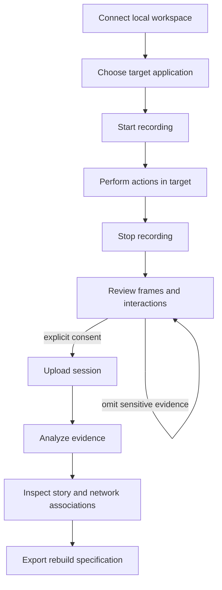

# Recorder conversion and workflow evidence specification

## Goal

Capture user-performed workflows on macOS and Ubuntu and turn reviewed evidence into an actionable rebuild specification. The recorder must not operate the target application. All captured material stays local until the user explicitly uploads it. Platform parity means equivalent user outcomes, not identical OS APIs.

## User stories

1. As a user, I can connect a local workspace and select a target application, so capture is scoped to that app.
2. As a user, I can start and stop recording and review each retained frame and interaction before uploading.
3. As a user, I can omit sensitive evidence and upload only after explicit confirmation.
4. As a reviewer, I can follow each user story from screen to screen, see the action and any observed network calls, and distinguish missing data from an observation of no calls.
5. As a coding agent, I can use the exported stories, screenshots, contracts, gaps and acceptance criteria to rebuild the recorded behavior.

## Evidence model for every frame

Each frame in the story must have a stable identifier and local image reference, timestamp, session and platform. Associate the preceding and following action where evidence permits, with action type, target and timestamp. Include a page or window name and purpose only when supported by captured metadata or clearly labeled as an inference; otherwise mark unknown. List network requests observed in the relevant time window with method, sanitized URL, status and timestamp, and label the link to the action as timing-based. If capture was disabled, incomplete, or the time window is unknown, say **not observed**; do not claim there were no requests. Never fabricate endpoint paths or screenshot annotations. Retain evidence identifiers so a reviewer can trace all generated claims to source data.

## Platform work

- macOS: retain the existing Swift recorder, permission checks, scoped application capture, local review and explicit upload. Verify on a real supported Mac.
- Ubuntu: provide the same lifecycle using supported Linux capture and accessibility mechanisms. Detect the desktop session and report unavailable permissions or unsupported capture paths. Wayland restrictions vary by compositor; do not imply global input capture works when it does not. Verify X11 and supported Wayland configurations separately.
- Network capture is optional and separate from screen capture. Use the existing sanitized helper and clearly communicate its coverage and limitations. Do not intercept traffic without the user's setup and consent.

## Agent implementation plan

1. Inspect the recorder's session schema and backend ingestion contract before modifying either. Preserve compatibility or version the schema and provide migration coverage.
2. Implement platform-specific capture behind a common session model. Unit-test serialization and review filtering; exercise permissions and target scoping on each platform.
3. Build a story graph from ordered interactions and frames. Link calls by time only and preserve raw evidence references. Provide an explicit unknown state for missing page purpose, action or network evidence.
4. Generate a spec containing ordered user stories, acceptance scenarios, referenced screenshots, network contracts where observed, platform assumptions, privacy boundaries and unresolved gaps. A coding agent may delegate independent platform or UI tasks; consolidate and verify against the same acceptance criteria.
5. Test end-to-end with a controlled application and known requests, including zero requests, capture disabled, omitted frames, failed upload and partial analysis. Validate on actual Ubuntu and macOS installations; automated tests cannot establish OS permission behavior.

## Acceptance criteria

- Each retained screenshot in an exported story has an action, location, purpose and request association, or an explicit unknown/not-observed value with its reason.
- No timing-based network association is presented as a confirmed causal link.
- Review exclusions remain excluded from uploads and generated artifacts.
- Unsupported platform capabilities and permission failures are visible and recoverable; no silent fallback claims complete capture.
- The generated spec identifies its source evidence and unresolved gaps and can be used without inventing missing behavior.
